<div align="center">

# 💼 MypesOS

### El Sistema Operativo Financiero y Contable con Inteligencia Artificial para MYPES & PYMES

*Control integral de ingresos, egresos, flujo de caja, proyectos, nóminas, impuestos (IGV/IVA) y patrimonio en un libro contable estricto de partida doble.*

<br/>

[](https://github.com/Jaxsdev/Mypes.OS)
[](https://github.com/Jaxsdev/Mypes.OS/actions)
[](#-despliegue-con-docker)

<br/>

```
Captura (OCR) ➔ Conecta (Bancos/Billeteras) ➔ Comprende (IA & Métricas) ➔ Actúa (Reportes & PLE)
```

[✨ Características](#-características-principales) • [📸 Vistas](#-galería-de-vistas-mypesos) • [🏗️ Arquitectura](#%EF%B8%8F-arquitectura-del-sistema) • [🚀 Inicio Rápido](#-inicio-rápido) • [🐳 Docker](#-despliegue-con-docker) • [📖 Documentación API](#-microservicio-python-ai-engine)

</div>

---

## 📸 Galería de Vistas MypesOS

Explore las pantallas clave diseñadas y adaptadas para la realidad financiera y operativa de las micro y pequeñas empresas peruanas:

<div align="center">

### 1. Panel Principal MYPE (`/`)
*Consolidación en tiempo real de posición de caja en Soles (PEN 26.6K), flujo de caja operativo (+58.1%), saldos en cuentas BCP, billeteras digitales Yape/Plin, caja chica en efectivo y acceso directo al Scoring de Microfinanzas.*
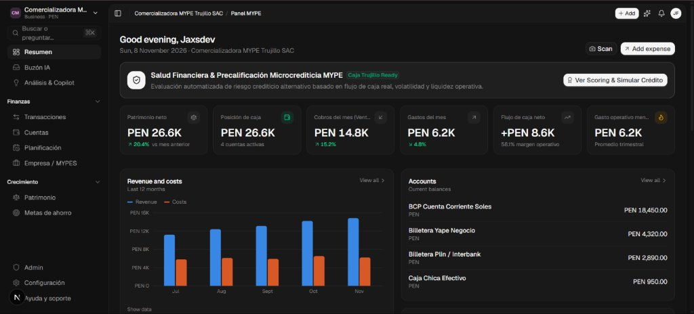

<br/>

| 2. Transacciones con Validación IA (`/transactions`) | 3. Saldos de Cuentas & Billeteras (`/accounts`) |
| :---: | :---: |
| *Libro contable inmutable de ingresos y egresos. Cada movimiento registra confianza de categorización IA (95% - 99%), comprobantes vinculados y cuenta bancaria de origen.* | *Arqueo de caja y cuentas corrientes: BCP Soles, Yape Negocio, Plin y Caja Chica física para control riguroso de movimientos diarios.* |
| 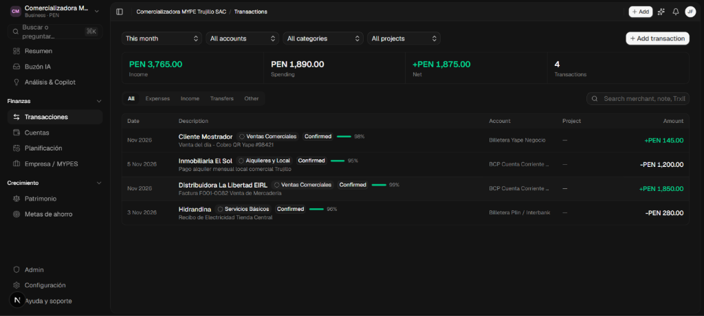 | 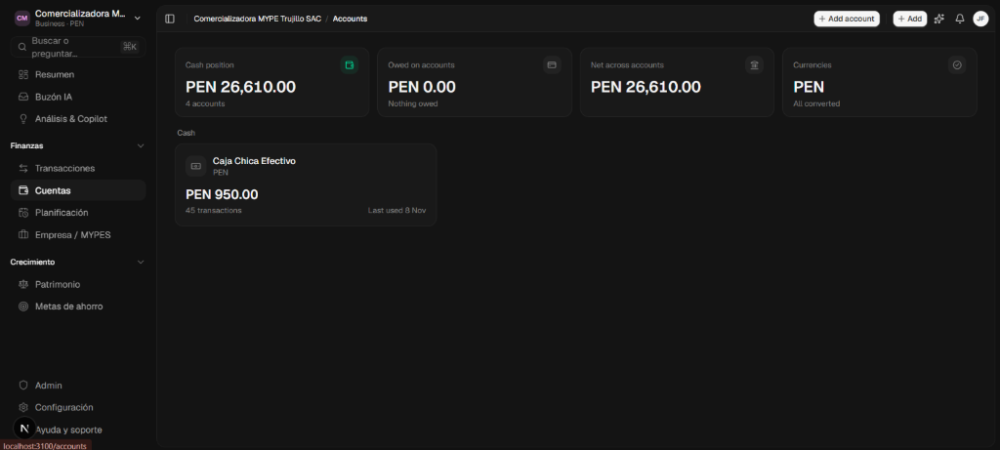 |

<br/>

| 4. Proyectos & Rentabilidad Comercial (`/business/projects`) | 5. Análisis & Margen Operativo (`/ai/insights`) |
| :---: | :---: |
| *Control por centros de costo y campañas (ej. Campaña Navideña 2026). Monitorea presupuesto utilizado (41.3%), gasto mensual y meses de liquidez restante.* | *Visión comparativa semestral de ingresos vs gastos, margen neto del 58.1% y detección temprana de desviaciones financieras.* |
| 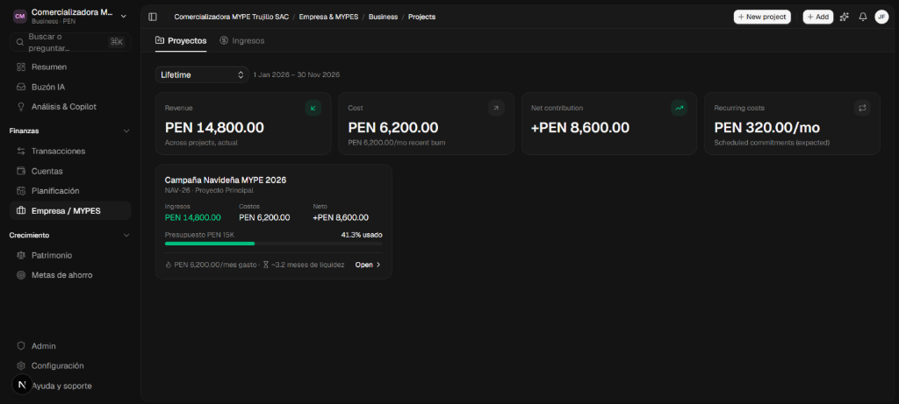 | 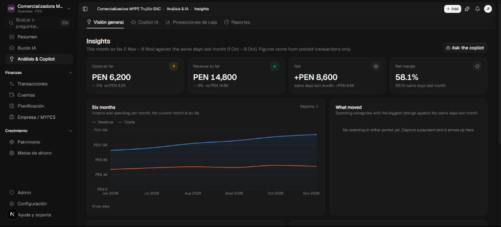 |

<br/>

| 6. Patrimonio Neto MYPE (`/wealth/net-worth`) | 7. Metas Financieras & Fondos de Reserva (`/goals`) |
| :---: | :---: |
| *Cálculo patrimonial estricto (Activos: S/ 30,010 - Pasivos: S/ 0). Evolución mensual (+20.4%) y desglose de cuentas bancarias y facturas por cobrar.* | *Planes de ahorro para capital de trabajo y contingencias. Progreso continuo (53% de S/ 50,000) con ritmo mensual sugerido.* |
| 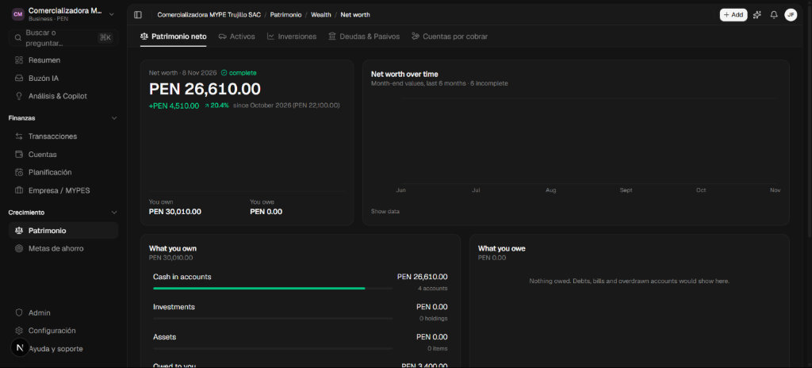 | 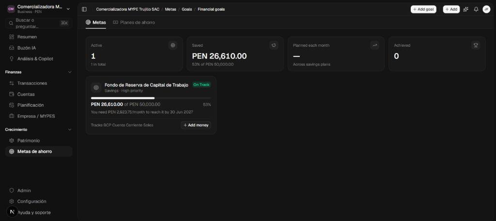 |

<br/>

| 8. Planificación & Costos Fijos (`/subscriptions`) | 9. Buzón Inteligente IA con Supervisión (`/ai/inbox`) |
| :---: | :---: |
| *Seguimiento de compromisos recurrentes (servicios de software, alquileres y suministros) proyectados a 30 días para evitar quiebres de caja.* | *Bandeja de confirmación humana: los borradores extraídos por OCR o transferencias bancarias requieren aprobación explícita antes de asentarse.* |
| 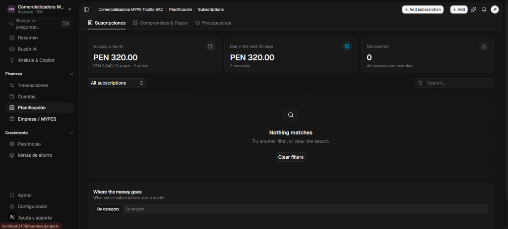 | 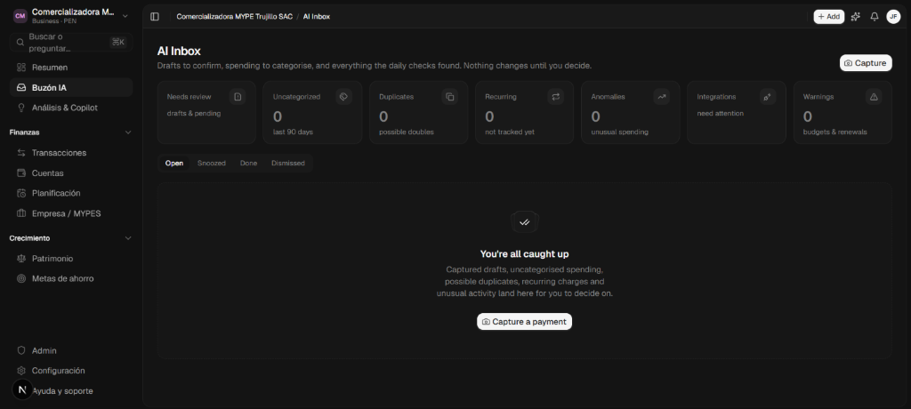 |

<br/>

| 10. Perfil de Negocio & Seguridad (`/settings`) |
| :---: |
| *Administración de credenciales, autenticación segura y configuración de identidad corporativa MYPE.* |
| 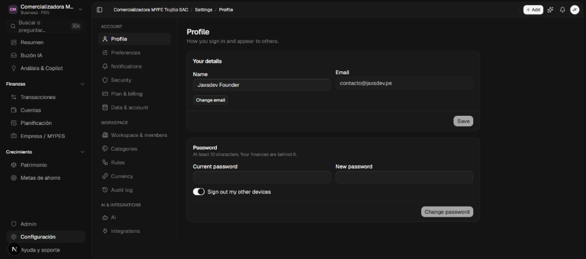 |

</div>

---

## 📌 ¿Por qué MypesOS?

Las micro y pequeñas empresas a menudo se ven obligadas a elegir entre:
* **Hojas de cálculo o apps personales:** Inadecuadas para impuestos, nóminas o proyectos.
* **Sistemas ERP tradicionales:** Costosos, rígidos, con interfaces obsoletas y curvas de aprendizaje lentas.

**MypesOS** unifica lo mejor de ambos mundos: una experiencia moderna, rápida e intuitiva, respaldada por un **libro contable de partida doble matemática**, inteligencia artificial supervisada y un motor de analítica tributaria en Python.

> [!IMPORTANT]
> **Filosofía Contable de MypesOS:**
> El libro contable (*ledger*) es la única e inmutable fuente de verdad. La IA procesa, extrae comprobantes y sugiere categorizaciones, pero **ninguna cifra o asiento contable se altera sin confirmación humana explícita**.

---

## 🏗️ Arquitectura del Sistema

MypesOS está diseñado como un ecosistema políglota distribuido (TypeScript + Python):

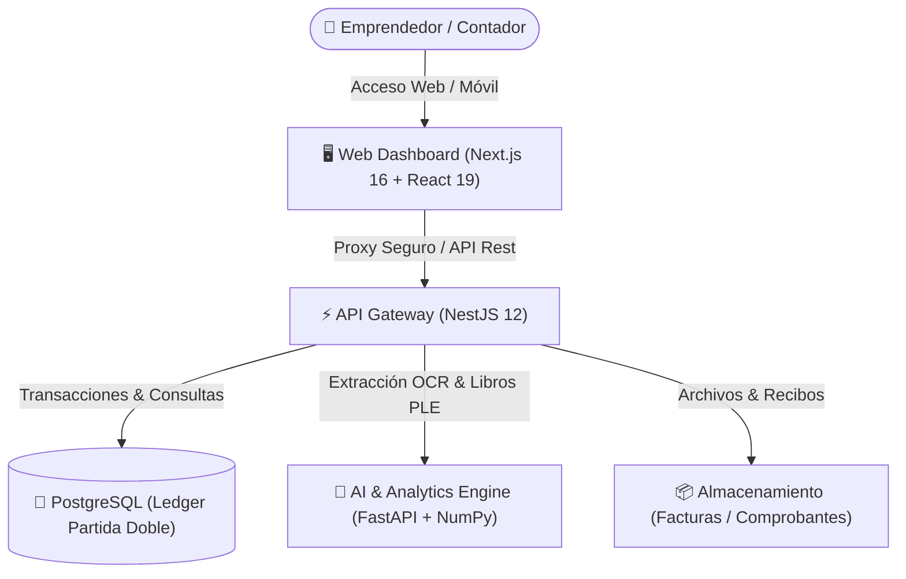

### 🧩 Estructura del Monorepo

| Directorio | Capa | Tecnología | Función |
| :--- | :--- | :--- | :--- |
| **`packages/core`** | Núcleo Financiero | TypeScript estricto | Motor contable puro, cálculo de dinero en enteros menores, Zod schemas y fechas |
| **`apps/api`** | Backend Central | NestJS 12, Drizzle ORM | Autenticación (Better Auth), aislamiento multi-tenant, auditoría contable |
| **`apps/web`** | Frontend Web | Next.js 16, Tailwind CSS v4 | Panel de control, dashboards, visualización de métricas y exportación |
| **`services/ai-engine`**| Motor de Analítica | Python 3.12, FastAPI, NumPy | Extracción OCR de facturas/boletas, pronósticos de liquidez y libros electrónicos |
| **`apps/desktop`** | App de Escritorio | Tauri 2 (Rust) | Instalador nativo de Windows (MSI) para escritorio |

---

## ✨ Características Principales

### 💰 1. Contabilidad de Partida Doble y Multidivisa
- **Aritmética Entera:** Registro exacto en céntimos/minor units para eliminar el margen de error de redondeo de punto flotante.
- **Multidivisa Completa:** Almacena importe original, divisa de la cuenta, monto base equivalente y tipo de cambio aplicado.
- **Billeteras Regionales:** Compatibilidad nativa con **Yape, Plin, Nequi, Daviplata, Mercado Pago**, bancos locales y pasarelas internacionales (Stripe, Wise, PayPal).

### 🧾 2. Desglose Tributario y Libros Electrónicos (PLE)
- **Cálculo de Impuestos:** Base imponible automática e IGV (18%) / IVA (19%) en modalidades inclusiva y exclusiva.
- **Registro de Ventas e Ingresos:** Generación automatizada conforme a la normativa para micro y pequeñas empresas.
- **Registro de Compras:** Cálculo de crédito fiscal deducible y exportación en formato oficial pipe-delimited (`|`).

### 🤖 3. Procesamiento en Lenguaje Natural y Copilot
- **Entrada Rápida en Español:** Escribe o dicta frases como *"Almuerzo 35 soles en restaurante con Yape ayer"* y el sistema inferirá categoría, fecha, método de pago y monto.
- **Copilot Financiero Supervisado:** Pregunta en lenguaje natural sobre saldos, gastos acumulados, cuentas por cobrar o proyecciones.
- **AI Inbox:** Bandeja de decisiones para aprobar o descartar borradores detectados antes de asentarlos en el libro.

### 📈 4. Flujo de Caja y Control de Negocio
- **Pronóstico a 30, 60 y 90 días:** Modelado estadístico con NumPy sobre la serie histórica de cobros y pagos.
- **Tasa de Quema (*Net Burn Rate*):** Indicador continuo de la velocidad de consumo de capital y días de liquidez restante (*runway*).
- **Proyectos & Rentabilidad:** Costos directos, ingresos por cliente y seguimiento de nómina mensual con comprobantes.

### 🏦 5. Score de Salud Financiera & Simulador de Microcrédito (Inclusión Financiera)
- **Scoring Crediticio Alternativo:** Algoritmo en Python que evalúa 4 dimensiones de riesgo sobre el libro mayor contable (Margen operativo, Estabilidad de ingresos, Cobertura de compromisos fijos y Días de liquidez de caja).
- **Precalificación y Clasificación (A/B/C/D):** Estimación inmediata del monto prudencial para microcrédito y plazo sugerido.
- **Simulador Interactivo de Cuotas:** Proyección en tiempo real bajo amortización francesa con semáforo de capacidad de pago contra el excedente operativo mensual libre.
- **Documentación Metodológica:** Consulta el diseño completo en [docs/ARQUITECTURA_MICROFINANZAS.md](docs/ARQUITECTURA_MICROFINANZAS.md).

---

## 🚀 Inicio Rápido

### Requisitos Previos
- **Node.js:** `>= 24.0.0`
- **pnpm:** `>= 10.0.0`
- **Python:** `>= 3.11` (para desarrollo local del microservicio de analítica)
- **Docker & Docker Compose**

### Instalación en 3 Pasos

```bash
# 1. Clonar el repositorio
git clone https://github.com/Jaxsdev/Mypes.OS.git
cd Mypes.OS

# 2. Configurar variables de entorno e instalar dependencias
cp .env.example .env
pnpm install

# 3. Iniciar base de datos y migrar esquema
pnpm db:up
pnpm db:migrate
```

### Ejecución en Modo Desarrollo

#### Opción 1: Modo Demo Rápido (Sin Docker ni dependencias externas)
```bash
# Inicia el servidor de datos mock y la web en paralelo
pnpm mock    # En terminal 1 (Puerto 4100)
pnpm web     # En terminal 2 (Puerto 3100)

# O en Windows ejecuta directamente:
.\iniciar-demo.ps1

# Ingreso directo: http://localhost:3100/demo
```

#### Opción 2: Pila Completa (PostgreSQL + Python Engine + NestJS + Next.js)
```bash
# Inicia la API (puerto 4100) y la Web (puerto 3100) en paralelo
pnpm dev

# En otra terminal, levanta el microservicio de IA en Python (puerto 8000)
cd services/ai-engine
python -m venv venv
.\venv\Scripts\activate   # En Linux/Mac: source venv/bin/activate
pip install -r requirements.txt
uvicorn main:app --reload --port 8000
```

---

## 🐳 Despliegue con Docker

Levanta la plataforma completa lista para producción (PostgreSQL + Python Engine + NestJS + Next.js) con un solo comando:

```bash
docker compose up -d --build
```

| Servicio | Puerto Local | Contenedor |
| :--- | :--- | :--- |
| **Web Dashboard** | `http://localhost:3100` | `mypesos-web` |
| **Backend API** | `http://localhost:4100` | `mypesos-api` |
| **AI & Analytics Engine** | `http://localhost:8000` | `mypesos-ai-engine` |
| **PostgreSQL** | `localhost:5436` | `mypesos-postgres` |

---

## 🧪 Pruebas Automatizadas

```bash
# Correr pruebas unitarias del núcleo financiero (TypeScript)
pnpm --filter @financeos/core test

# Correr pruebas del microservicio Python (FastAPI / Pytest)
cd services/ai-engine && pytest
```

---

## 📄 Licencia y Reconocimientos

Distribuido bajo la licencia **GNU Affero General Public License v3.0 (AGPL-3.0)**. Consulta el archivo [LICENSE](./LICENSE) para los términos completos.

*MypesOS es desarrollado y mantenido por [Jaxsdev](https://github.com/Jaxsdev) como un fork avanzado y especializado para el mercado de micro y pequeñas empresas.*
